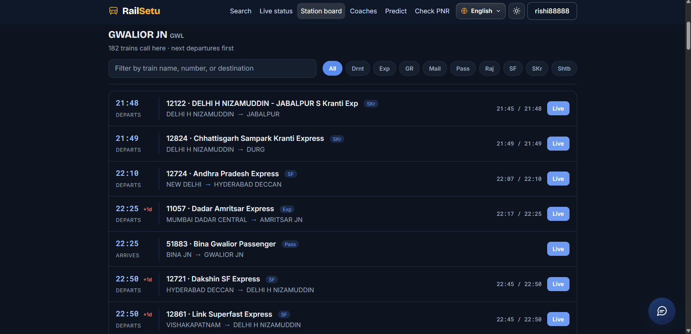
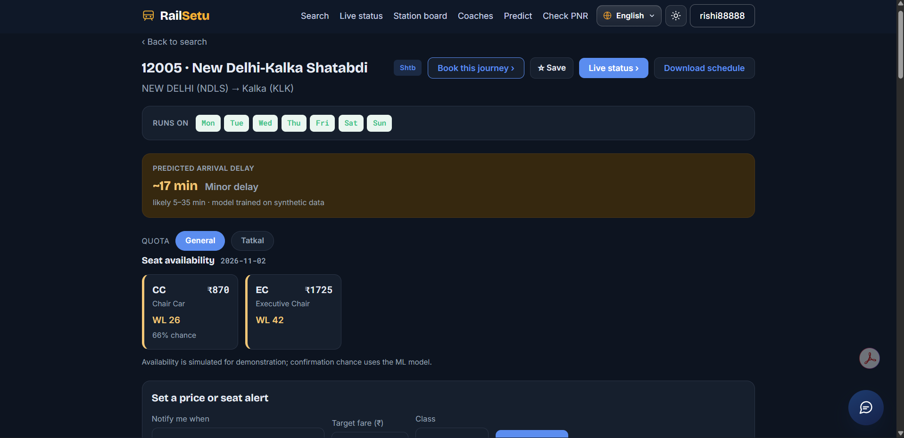
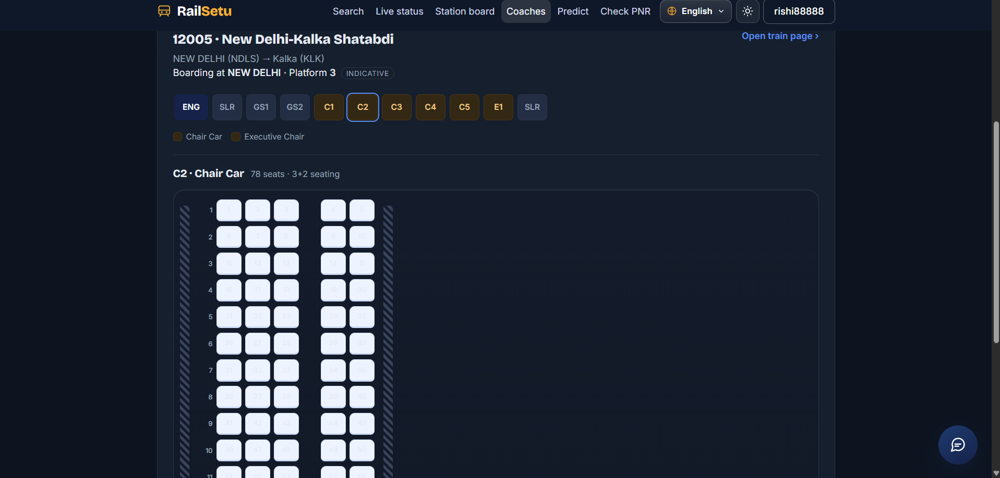
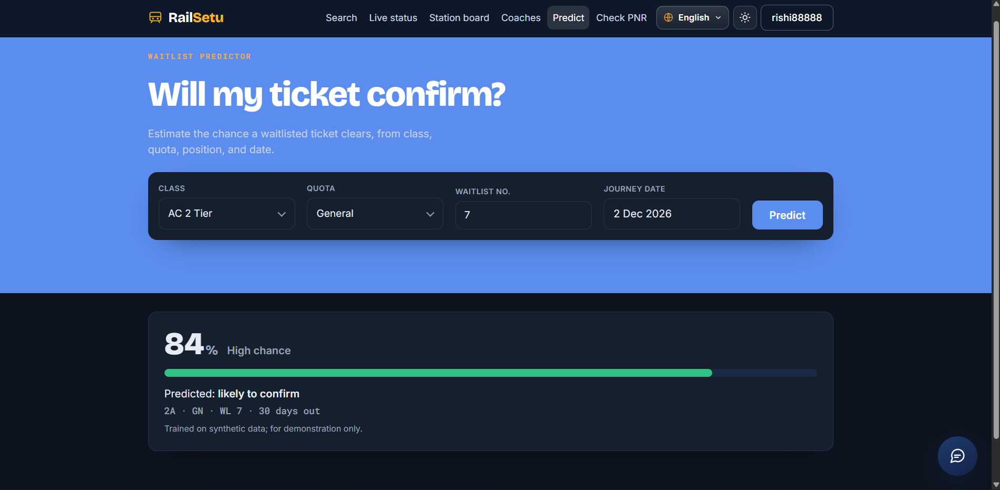

# RailSetu

A full-stack, IRCTC/ixigo-style Indian Railways platform: search trains between stations, check live running status and PNR, view coach and platform layouts, predict waitlist confirmation with machine learning, book multi-passenger tickets, and chat with a multilingual assistant. Built as a three-tier system (Django + DRF API, a separate FastAPI machine-learning service, and a dependency-free vanilla JavaScript frontend) and deployed on Render with Supabase PostgreSQL.

**Live demo:** https://railsetu.onrender.com
**ML service health:** https://railsetu-ml.onrender.com/health

> Free-tier hosting note: the services sleep after inactivity, so the first request may take 30 to 60 seconds to wake. Give it a moment on the first load.

> Data honesty: train and station data is the open DataMeet 2016 (CC0) dataset (~5,200 trains, ~8,900 stations). Fares, seat availability, PNR, platforms and coach positions are deterministic synthetic generators, labelled "indicative" in the UI. The genuinely real pieces are the train search over the dataset and the three machine-learning models.

---

## Screenshots

<!-- Put the image files in a docs/ folder at the repo root, then these will render. -->

| Search results | Train detail with ML delay |
| --- | --- |
|  |  |

| Coach seat map | Confirmation predictor |
| --- | --- |
|  |  |

---

## Architecture

Three independently deployable tiers:

```
                         ┌──────────────────────────────┐
   Browser  ──────────►  │  Django + DRF  (web, :8000)  │
   vanilla JS frontend   │  JSON API + serves frontend  │
                         └───────────┬──────────────────┘
                                     │  HTTP
                         ┌───────────▼──────────────────┐
                         │  FastAPI ML service  (:8001) │
                         │  3 scikit-learn models       │
                         └───────────┬──────────────────┘
                                     │
                         ┌───────────▼──────────────────┐
                         │  Supabase PostgreSQL         │
                         └──────────────────────────────┘
```

- **Web tier** (`backend/`): Django + Django REST Framework. Serves the JSON API and the frontend via TemplateView. JWT auth, bookings, alerts, analytics, chatbot, i18n.
- **ML tier** (`ml-service/`): a standalone FastAPI service hosting three scikit-learn models. Kept separate so the API stays responsive and the models can scale or be redeployed on their own. Django proxies to it and degrades gracefully (HTTP 503) when it is offline.
- **Frontend** (`frontend/`): hand-written HTML, CSS and JavaScript with no build step. Dark/light theming, a custom dropdown and date picker, and on-demand translation.

---

## Machine learning

Three models, each trained on synthetic data generated from domain rules, served by the FastAPI tier:

| Model | Type | Metric | What it powers |
| --- | --- | --- | --- |
| Waitlist confirmation | GradientBoostingClassifier | ROC AUC ~0.86 | Confirmation probability and band on the Predict page, booking gauge, train page and PNR |
| Arrival delay | GradientBoostingRegressor | MAE ~9.8 min | Predicted-delay banner on the train page |
| Train rank (learning-to-rank) | GradientBoostingRegressor | R-squared ~0.93 | The "Recommended" sort on search results (a 0 to 100 match score) |

`GET /health` on the ML service returns the load state of all three models.

---

## Features

- Train search between stations, with fastest/cheapest badges and an ML "Recommended" sort
- Live running status and station board
- PNR status and waitlist confirmation prediction
- Train detail: schedule, run days, coach position, platform, interior seat map
- Multi-passenger booking with PDF e-tickets and booking/cancellation emails
- Saved trains and routes, plus price and seat alerts
- Staff-only analytics dashboard
- Multilingual UI and a RAG chatbot (Groq) across 9 Indian languages
- JWT authentication and Google OAuth sign-in
- Dark and light themes

---

## Tech stack

**Backend:** Python, Django, Django REST Framework, SimpleJWT, FastAPI, scikit-learn
**Frontend:** vanilla HTML / CSS / JavaScript (no framework, no build step)
**Database:** PostgreSQL (Supabase in production, SQLite for local dev)
**Infra:** Render (two web services), WhiteNoise static serving, GitHub Actions keep-alive, CI/CD on push
**Integrations:** Google OAuth, Groq LLM (chatbot + translation), RapidAPI (live status)

---

## Local setup

Prerequisites: Python 3.11+.

**1. Backend (web API + frontend), from `backend/`:**

```bash
python -m venv .venv
.venv\Scripts\activate          # Windows
pip install -r requirements.txt
python manage.py migrate
python manage.py runserver       # http://localhost:8000
```

With no `DATABASE_URL` set, it uses a local SQLite database automatically.

**2. ML service, from `ml-service/`:**

```bash
pip install -r requirements.txt
python train.py && python train_delay.py && python train_rank.py   # regenerate the .joblib models
python -m uvicorn app:app --port 8001                              # http://localhost:8001
```

The `.joblib` model files are not committed; the train scripts regenerate them locally.

Open the site at `http://localhost:8000` (not `file://`), which is required for Google sign-in.

### Key environment variables

Set these in `backend/.env` (git-ignored):

| Variable | Purpose |
| --- | --- |
| `DATABASE_URL` | PostgreSQL connection string (omit for local SQLite) |
| `DJANGO_SECRET_KEY` | Django secret key (required when `DEBUG=0`) |
| `DJANGO_DEBUG` | `1` for local dev, `0` in production |
| `ML_SERVICE_URL` | URL of the FastAPI ML service |
| `GOOGLE_CLIENT_ID` / `GOOGLE_CLIENT_SECRET` | Google OAuth |
| `GROQ_API_KEY` | Chatbot and translation |
| `LIVE_API_KEY` | Live running status provider (optional) |
| `EMAIL_*` | SMTP for booking emails (optional) |

---

## Selected API endpoints

- `POST /api/auth/register/`, `/login/`, `/refresh/`, `/me/` for JWT auth
- `GET  /api/health/` for service health
- `POST /api/predict/confirmation/`, `/api/predict/delay/`, `/api/predict/rank/` for ML proxies
- Train search, PNR, live status and booking endpoints under `/api/`

---

## Author

**Rishi Raj Das**, B.Tech Information Technology, MITS Gwalior
GitHub: [github.com/rishirajdas05](https://github.com/rishirajdas05)

Built as an independent portfolio project. The engineering is real; the railway numbers are synthetic, by design.